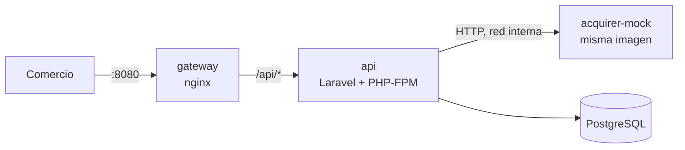
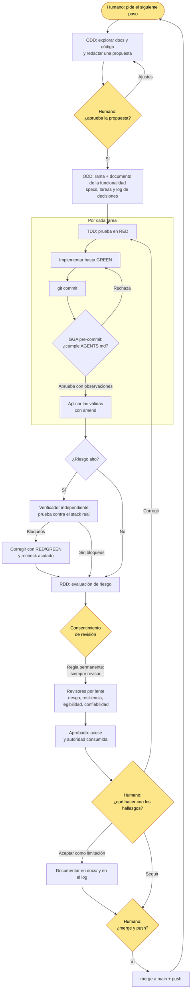

# Payment Processing Service

Servicio que recibe pagos de múltiples comercios, valida los datos, aplica reglas de negocio, pide la
autorización a un adquirente simulado (Acquirer Mock) y registra cada transacción con su historial
completo. Está construido con Laravel 13, PostgreSQL 18 y Docker, e incluye una vista web en
Angular 22 para consultar transacciones.

## Ruta rápida

Requisitos: Docker con Docker Compose v2.

1. Crear la configuración a partir de la plantilla:

   ```sh
   cp .env.example .env
   ```

2. Completar en `.env`:
   - `DB_DATABASE`, `DB_USERNAME` y `DB_PASSWORD`, con los valores que elijas.
   - `APP_KEY`, generada con:

     ```sh
     echo "base64:$(openssl rand -base64 32)"
     ```

3. Levantar el stack. La API ejecuta las migraciones al arrancar.

   ```sh
   docker compose up -d --build
   ```

4. Verificar que <http://localhost:8080/up> responda `200`. La vista web queda en
   <http://localhost:8080/transactions>.

5. Enviar un pago:

   ```sh
   curl -s -X POST http://localhost:8080/api/payments \
     -H 'Content-Type: application/json' -H 'Accept: application/json' \
     -H 'Idempotency-Key: key-001' -H 'X-Correlation-Id: corr-123' \
     -d '{"merchant_id":"merchant-001","amount":15000,"currency":"CLP",
          "card":{"number":"4111111111111111","holder_name":"Ada Lovelace",
                  "expiry_month":12,"expiry_year":2030,"cvv":"123"}}'
   ```

   Respuesta `201 Created`:

   ```json
   {
     "transaction_id": "01a1431b-3cc8-7219-a7c6-2b96894de9e6",
     "merchant_id": "merchant-001",
     "amount": 15000,
     "currency": "CLP",
     "status": "APPROVED",
     "decline_reason": null,
     "card": { "brand": "VISA", "last4": "1111" },
     "created_at": "2026-10-16T05:07:00.936+00:00",
     "updated_at": "2026-10-16T05:07:00.961+00:00"
   }
   ```

## Uso de la API

| Método y ruta | Qué hace | Detalle |
|---------------|----------|---------|
| `POST /api/payments` | Crea y procesa un pago de forma síncrona. | Exige el header `Idempotency-Key`. Responde `201` con el estado final; si se repite la solicitud, devuelve la respuesta original con `Idempotent-Replayed: true`. |
| `GET /api/payments/{transaction_id}` | Consulta una transacción. | Los mismos campos que la creación, más `events`: el historial completo en orden. |
| `GET /api/payments` | Lista transacciones. | Filtros opcionales `merchant_id` y `status`. Del más reciente al más antiguo; `per_page` de 20 por defecto, con un máximo de 100. |

Datos clave del contrato:

- **Montos:** son enteros en unidades mínimas de la moneda: `15000` CLP son $15.000 y `1050` USD
  son US$10,50. Un decimal o un texto se rechazan con `422`.
- **Rechazos:** los de negocio y los del adquirente **no** son errores HTTP. Responden `201`, con
  `status` `DECLINED` o `FAILED` y su `decline_reason`.
- **Errores:** todos usan el mismo formato `{"error": {"code", "message", "details"}}`. Los códigos
  están en la
  [sección 8 del análisis de requerimientos](docs/01-requirements-analysis.md#8-códigos-de-error).
- **Correlación:** toda respuesta, incluidas las de error, devuelve `X-Correlation-Id`.
- **Fechas:** se muestran en hora de Santiago, en ISO 8601 con su offset (por ejemplo
  `2026-10-15T09:00:00.000-03:00`). Se almacenan y se registran en UTC, y el vencimiento de la
  tarjeta se evalúa con el mes de Santiago (DD-06). La zona se configura con
  `PAYMENTS_BUSINESS_TIMEZONE`.

### Tarjetas de prueba

El Acquirer Mock responde según el número de tarjeta:

| Tarjeta | Resultado |
|---------|-----------|
| `4111111111111111` (o cualquier otra válida) | `APPROVED` |
| `4000000000000002` | `DECLINED` con `INSUFFICIENT_FUNDS` |
| `4000000000000259` | Falla una vez de forma temporal y se aprueba en el reintento |
| `4000000000000119` | Falla en los 3 intentos: `FAILED` con `ACQUIRER_UNAVAILABLE` |
| `4111111111111112` | No cumple Luhn: `DECLINED` con `INVALID_CARD_NUMBER`, sin llamar al adquirente |

### Vista web

<http://localhost:8080/transactions> lista las transacciones con filtros por comercio y estado, y
con paginación. Al abrir una transacción se ven su detalle y su historial de eventos (HU-12). Los
filtros y la página quedan en la URL, así que una búsqueda se puede compartir. La vista muestra
estados de carga, vacío y error con "Reintentar", y cumple WCAG AA: etiquetas, navegación con
teclado, foco visible y contraste. La interfaz está en español neutro; los datos (estados, motivos,
identificadores, montos y fechas) se muestran tal como los entrega la API.

### Seguir una transacción en los logs

Los logs son JSON por `stderr`, y cada línea lleva `correlation_id` y, una vez creada la
transacción, `transaction_id`. Para ver el recorrido completo a través de la API y el adquirente:

```sh
docker compose logs api acquirer-mock | grep corr-123
```

## Arquitectura



La API es un monolito modular con **arquitectura hexagonal** (DA-01). El dominio es PHP puro, y la
regla de dependencias entre capas se verifica con pruebas `arch()` de Pest:

| Capa | Responsabilidad |
|------|-----------------|
| `Payments/Domain` | El agregado `Transaction`, los value objects, las reglas de negocio y los puertos. Sin Laravel. |
| `Payments/Application` | Casos de uso: `ProcessPayment`, `GetTransaction` y `ListTransactions`, más la política de reintentos. |
| `Payments/Infrastructure` | Persistencia con Eloquent, idempotencia en PostgreSQL y el cliente HTTP del adquirente. |
| `Payments/Http` | Controllers sin lógica, Form Requests y API Resources. |
| `Shared` | Correlación y formato único de errores. |
| `AcquirerMock` | El simulador, activo solo en su contenedor. |
| `web/` (Angular) | La vista de consulta: un servicio para la API, containers que coordinan y componentes de presentación. |

Flujo de `POST /api/payments`:

1. Se resuelve el identificador de correlación y se valida la entrada.
2. Se reserva la clave de idempotencia con `INSERT … ON CONFLICT DO NOTHING`.
3. Se crea la transacción en `PENDING`.
4. Se evalúan las reglas de negocio. Si alguna falla, la transacción termina en `DECLINED`.
5. Si no, pasa a `PROCESSING`, se llama al adquirente con hasta 3 intentos y backoff
   exponencial, y se guarda el estado final.
6. Se guarda la respuesta en la clave de idempotencia y se devuelve `201`.

Cada paso se confirma por separado, y ninguna transacción de base de datos queda abierta durante la
llamada al adquirente (DA-04). El detalle completo, con diagramas, está en la
[arquitectura](docs/04-architecture.md).

## Decisiones técnicas

| Decisión | Motivo |
|----------|--------|
| Montos enteros en unidades mínimas ([SUP-02](docs/01-requirements-analysis.md#61-representación-de-montos)) | Sin ambigüedad de formato ni errores de redondeo. Es la convención de Stripe, Adyen e ISO 8583. |
| Estado actual en `transactions` e historial en `transaction_events`, de solo inserción (DD-03, DD-11) | Consultar por estado es directo, y un trigger impide modificar o borrar eventos. |
| Restricciones `CHECK` sobre estado, moneda, monto y motivos (DD-12) | Las invariantes del dominio se cumplen incluso ante un error en la aplicación. |
| Idempotencia con una restricción única por comercio y clave (DD-09, DA-06) | La base de datos resuelve las solicitudes concurrentes, sin locks en memoria. |
| La huella de idempotencia es un HMAC-SHA256 y excluye el CVV (DD-10) | No se puede revertir por fuerza bruta, y el CVV no se conserva en ninguna forma después de autorizar (PCI DSS). |
| Reintentos en la capa de aplicación y no en el cliente HTTP (DA-05) | Cada intento queda registrado como evento, con su duración y su error. |
| Solo errores temporales se reintentan; un `4xx` del adquirente termina en `FAILED` con `ACQUIRER_ERROR` | Repetir una solicitud que el adquirente rechazó por integración volvería a fallar. |
| El cliente del adquirente no sigue redirecciones | Una redirección reenviaría los datos de tarjeta a otro host. |
| Acquirer Mock como contenedor aparte con la misma imagen (DA-03) | Se prueba la integración real por HTTP (timeouts y errores), sin exponer el mock por el gateway. |
| Logs JSON por `stderr` con el `Context` de Laravel (DA-07) | Se sigue una transacción entre contenedores con un solo `grep`. |
| Pruebas contra PostgreSQL y no contra SQLite (DA-09) | Las restricciones, el trigger y `ON CONFLICT` forman parte del comportamiento. |

Las decisiones completas están en el [modelo de dominio](docs/03-domain-model.md#8-decisiones-de-diseño)
(`DD-xx`) y en la [arquitectura](docs/04-architecture.md) (`DA-xx`).

## Supuestos

El enunciado deja abiertos varios puntos. Estos son los supuestos principales; la lista completa
está en la [sección 6 del análisis de requerimientos](docs/01-requirements-analysis.md#6-ambigüedades-y-supuestos).

| Supuesto | Decisión |
|----------|----------|
| Autenticación de comercios (SUP-01) | Fuera de alcance: `merchant_id` viaja en el cuerpo y se considera confiable. |
| Monedas y límites (SUP-03, SUP-04) | `CLP` y `USD`. Límite configurable: CLP 5.000.000 y USD 5.000,00. |
| Procesamiento (SUP-07, SUP-08) | Síncrono: la respuesta trae el estado final, con `201` incluso si se rechaza. |
| Reintentos (SUP-10) | Hasta 3 intentos, con backoff de 200 ms y 400 ms más jitter. |
| Idempotencia (SUP-11) | `Idempotency-Key` es obligatorio y su ámbito es el comercio. Otro contenido con la misma clave responde `409`. |
| Correlación (SUP-12) | Se usa `X-Correlation-Id` si tiene hasta 64 caracteres visibles; si no, se genera un UUID. |

## Limitaciones conocidas

- **Clave bloqueada.** Si el proceso muere entre la reserva de la clave y la respuesta, la clave
  queda en `IN_PROGRESS` y los reintentos reciben `409`. Queda registrado como advertencia en los
  logs.
- **Resultado ambiguo (SUP-15).** Un timeout cuando el adquirente sí autorizó se trata como error
  temporal. En producción haría falta una consulta o un reverso.
- **Paginación por desplazamiento.** Las páginas muy profundas son costosas; la evolución sería
  paginar por cursor.
- **Sin autenticación:** ver SUP-01.

## Pruebas

La API tiene pruebas automatizadas con Pest, contra PostgreSQL, en una base separada de la de
desarrollo:

- **Unitarias** del dominio y de los casos de uso, sin framework y con reloj fijo.
- **De integración** de la persistencia: restricciones, trigger e idempotencia.
- **De punta a punta** de cada escenario Gherkin de las
  [historias de usuario](docs/02-user-stories.md), con el adquirente simulado.
- **De arquitectura**, que verifican la regla de dependencias entre capas.

```sh
docker compose exec -T api php artisan test --compact
```

La vista web tiene sus propias pruebas con Vitest. Cubren el servicio de la API, cada componente
con verificaciones de accesibilidad de axe, los escenarios de HU-12 y el contraste de la paleta:

```sh
docker compose exec -T web npx ng test --watch=false
```

### Colección de Postman

[`postman/payments-api.postman_collection.json`](postman/payments-api.postman_collection.json)
recorre la API por historia de usuario (HU-01 a HU-11, más el formato de errores), con
verificaciones automáticas en cada solicitud contra el stack levantado.

- **Postman:** importar el archivo y ejecutar la colección completa, en orden, con el Collection
  Runner. La variable `baseUrl` apunta a `http://localhost:8080`.
- **Línea de comandos**, con Newman:

  ```sh
  npx newman run postman/payments-api.postman_collection.json
  ```

La primera solicitud genera un identificador único por corrida, así que la colección se puede
ejecutar muchas veces sin que choquen las claves de idempotencia. Las fechas de vencimiento se
calculan respecto del mes en curso.

La base `payments_test` se crea al inicializar el volumen de PostgreSQL
([script](docker/postgres/initdb/01-create-test-database.sh)). Si el volumen es anterior, se crea
una sola vez con:

```sh
docker compose exec postgres sh -c 'createdb -U "$POSTGRES_USER" payments_test'
```

## Configuración

- El `.env` de la raíz es la **única** fuente de configuración. Docker Compose entrega los mismos
  valores a PostgreSQL y a la API, así que no pueden quedar desalineados.
- `.env` está ignorado por git. `.env.example` es la plantilla versionada y no contiene secretos.
- Si falta un valor obligatorio, `docker compose` se detiene e indica qué variable completar.
- Dentro de Docker la API no usa `api/.env`: toma su configuración de las variables del
  contenedor.
- PostgreSQL solo aplica las credenciales al crear su volumen. Para cambiarlas hay que recrearlo
  con `docker compose down -v`, lo que **borra los datos**.

## Uso de asistentes de IA

Se usó **Claude Code** (Anthropic) como asistente durante todo el desarrollo, siempre con una
propuesta previa aprobada por mí antes de implementar cada paso.

| Para qué | Cómo se controló |
|----------|------------------|
| Analizar el enunciado y redactar la documentación de `docs/`: requerimientos, historias, dominio y arquitectura. | Revisé y aprobé cada documento. Las decisiones de producto y de diseño fueron mías, por ejemplo la representación de los montos, sacar el CVV de la huella y la regla del identificador de correlación. |
| Implementar por unidades pequeñas con TDD: dominio, persistencia, caso de uso, adquirente y endpoints. | Cada regla empezó con una prueba que fallaba. Las reglas del proyecto están en [AGENTS.md](AGENTS.md). |
| Revisar el código. | **Gentleman Guardian Angel** revisa cada commit contra AGENTS.md antes de aceptarlo. Además, un agente verificador independiente probó cada unidad con datos reales y encontró defectos que se corrigieron antes del merge: un pago aprobado que respondía `500` ante un carácter NUL, un desborde de paginación y una respuesta cortada del adquirente que escapaba de su contrato. |

Todo el código pasó por las pruebas automatizadas y por mi revisión antes de integrarse a `main`.

### Flujo de trabajo: ODD, GGA, RDD y humano en el ciclo

La IA escribe, pero no decide sola ni se revisa sola. Cada capa de control atrapa un tipo distinto
de error y deja evidencia. Las decisiones de producto y de entrega quedan en manos humanas (en
amarillo en el diagrama).



| Capa | Qué controla | Qué error atrapa | Evidencia que deja |
|------|--------------|------------------|--------------------|
| **ODD** (Organic Driven Development) | El proceso: primero explorar y proponer, después un documento con specs y tareas, y TDD por tarea. | Construir algo que no se pidió, o perder el hilo entre sesiones. | [`odd/tasks/`](odd/tasks): las specs citan los requerimientos y el log registra cada decisión. |
| **GGA** (Gentleman Guardian Angel) | Cada commit, contra las reglas de [AGENTS.md](AGENTS.md). | Violaciones locales: lógica en un controller, código muerto, falta de pruebas, datos de tarjeta en logs. | Commits rechazados y observaciones aplicadas. |
| **Verificador independiente** | Cada unidad terminada, probada **contra el stack real** con datos hostiles. | Defectos que las pruebas propias no ven, porque las escribió el mismo autor. | Veredicto por spec y reproducción de cada bloqueo. |
| **RDD** (Receipt-Driven Development) | La rama completa, con revisores por lente sobre una copia inmutable del código. | Riesgos de diseño: alcance global de un handler, carreras, contratos ambiguos. | Un acuse de revisión con su linaje, y los hallazgos clasificados. |
| **Humano en el ciclo** | Las decisiones de producto y de entrega. | Que la IA resuelva por su cuenta algo que es una decisión de negocio. | Las instrucciones textuales, registradas en el log de cada funcionalidad. |

Los puntos de decisión humana son cuatro:

1. **Antes de implementar:** se aprueba una propuesta, nunca código ya escrito.
2. **Ante una decisión de diseño real:** se presenta con su recomendación y su costo. Ejemplos:
   sacar el CVV de la huella, la regla del `X-Correlation-Id` o la forma del detalle en los `GET`.
3. **Con los hallazgos de la revisión:** se decide qué se corrige y qué queda como limitación
   documentada.
4. **Merge y push:** siempre los pide la persona.

El consentimiento de RDD es el único punto automatizado a conciencia, con una regla permanente:
"siempre revisar los cambios RDD en este proyecto".

Las capas son complementarias, no redundantes. Cada una encontró algo que las demás no habían
visto:

- **GGA** rechazó un commit porque un cambio de validación no tenía prueba en el Form Request.
- **El verificador** encontró que un carácter NUL en `merchant_id` aprobaba el cobro pero respondía
  `500` y dejaba la clave bloqueada. Las pruebas unitarias, GGA y el autor no lo habían visto.
- **RDD** detectó que el reporte de errores del módulo de pagos atrapaba errores de **toda** la
  aplicación: un problema de alcance, no de una línea de código.
- **El humano** cuestionó la regla de correlación propuesta. Al revisarla resultó más estricta de
  lo necesario, y se corrigió antes de implementarla.

La IA aceleró la escritura; las capas de control y las decisiones humanas son las que hacen
confiable el resultado.

## Documentación del diseño

- [Análisis de requerimientos](docs/01-requirements-analysis.md): requerimientos, supuestos, tarjetas de prueba y códigos de error.
- [Historias de usuario](docs/02-user-stories.md): criterios de aceptación y escenarios Gherkin.
- [Modelo de dominio](docs/03-domain-model.md): agregado, máquina de estados, reglas y modelo de datos.
- [Arquitectura](docs/04-architecture.md): contenedores, capas, flujo, observabilidad y manejo de errores.
- [Reglas del proyecto](AGENTS.md): principios, capas y criterios de revisión.
