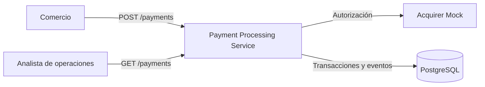
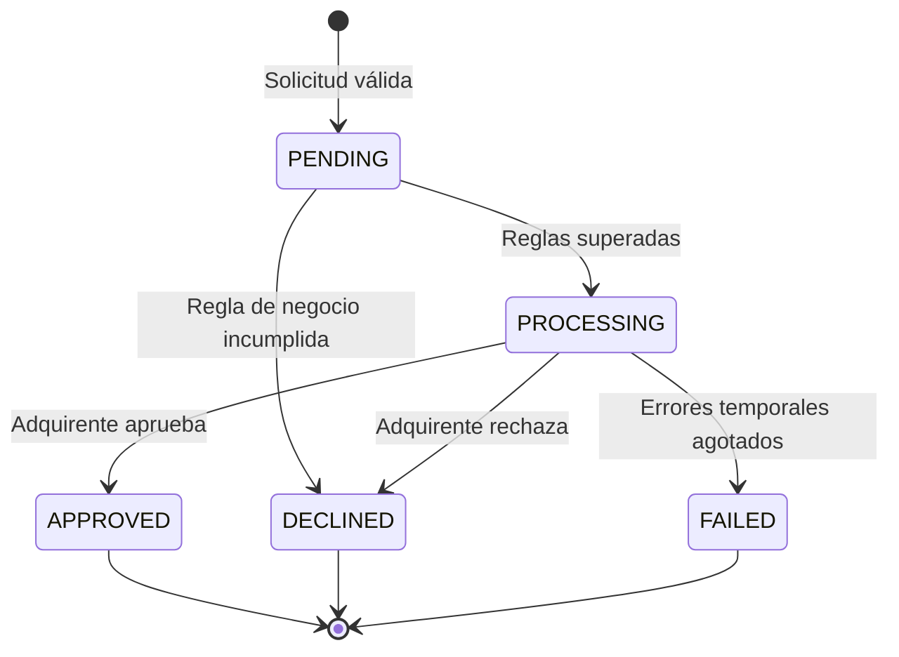

# Análisis de requerimientos — Payment Processing Service

Fuente: enunciado del desafío técnico de Haulmer (PDF confidencial, excluido del repositorio).
Este documento reformula los requerimientos, hace explícitas las ambigüedades y registra los
supuestos adoptados para resolverlas. Las historias de usuario y sus escenarios de aceptación
están en [02-user-stories.md](02-user-stories.md).

## 1. Resumen del problema

Un **Payment Processing Service**, dentro de una plataforma de pagos, recibe solicitudes de pago
de múltiples comercios, las valida, aplica reglas de negocio, solicita a un **adquirente** externo
que las autorice o rechace, y registra el estado de cada transacción con trazabilidad completa.

## 2. Actores

| Actor | Descripción |
|-------|-------------|
| Comercio | Cliente de la API que envía pagos y consulta su resultado. |
| Analista de operaciones | Persona que investiga transacciones (soporte, conciliación). Usa la API o la vista web opcional. |
| Adquirente (mock) | Sistema externo que autoriza o rechaza un pago; puede fallar de forma temporal. |

## 3. Requerimientos funcionales

| ID | Requerimiento (según el enunciado) |
|----|------------------------------------|
| RF-01 | Exponer `POST /payments` para recibir solicitudes de pago. |
| RF-02 | La solicitud incluye `merchant_id`, monto, moneda y datos de tarjeta. |
| RF-03 | Validar los datos de entrada antes de procesar la transacción. |
| RF-04 | Crear una nueva transacción con un estado inicial. |
| RF-05 | Aplicar reglas de negocio básicas (por ejemplo, monto máximo o validación de tarjeta). |
| RF-06 | Enviar la transacción a un **Acquirer Mock** que simule la autorización. |
| RF-07 | Actualizar el estado final de la transacción según la respuesta del adquirente. |
| RF-08 | `GET /payments/{transaction_id}` devuelve una transacción. |
| RF-09 | `GET /payments?merchant_id=...&status=...` lista transacciones con filtros. |
| RF-10 | *(Opcional)* Vista en Angular para consultar transacciones. |

Estados sugeridos: `PENDING`, `PROCESSING`, `APPROVED`, `DECLINED`, `FAILED`.

## 4. Requerimientos no funcionales

| ID | Requerimiento (según el enunciado) | Cómo se abordará |
|----|------------------------------------|------------------|
| RNF-01 | Persistir las transacciones en una base de datos. | PostgreSQL 18. |
| RNF-02 | Modelo de datos pensado para la trazabilidad. | Tabla `transaction_events` de solo inserción, que registra cada cambio de estado con fecha, motivo e identificador de correlación. |
| RNF-03 | Manejar adecuadamente errores de validación y fallos del sistema. | Formato de error JSON uniforme con códigos estables; nunca se exponen trazas internas. |
| RNF-04 | Evitar transacciones duplicadas mediante idempotencia. | Header `Idempotency-Key` obligatorio, único por comercio. |
| RNF-05 | Considerar errores temporales del adquirente. | Reintentos acotados con backoff exponencial y timeout; `FAILED` al agotarlos. |
| RNF-06 | Logs que permitan seguir el flujo completo de una transacción. | Logs estructurados (JSON) en cada paso. |
| RNF-07 | Correlacionar eventos y acciones de una misma transacción. | `X-Correlation-Id` propagado a logs, eventos, llamadas al adquirente y respuesta. |
| RNF-08 | *(Entregable)* Ejecución local con Docker. | Stack con Docker Compose (realizado en `070abe7`). |
| RNF-09 | *(Entregable)* Pruebas unitarias y de reglas de negocio. | Pest. |
| RNF-10 | *(Derivado)* Proteger los datos de tarjeta. | Nunca persistir ni registrar en logs el número completo ni el CVV; solo se guardan la marca y los últimos 4 dígitos. |

## 5. Ciclo de vida de la transacción

- `APPROVED`, `DECLINED` y `FAILED` son **finales**: no admiten ninguna transición posterior.
- Cualquier otra transición es rechazada por el dominio y constituye un error de programación.

## 6. Ambigüedades y supuestos

El enunciado deja abiertos los siguientes puntos. Cada uno se resuelve con un supuesto explícito
que puede revisarse.

| ID | Ambigüedad | Supuesto |
|----|------------|----------|
| SUP-01 | Cómo se autentican los comercios. | Fuera de alcance. `merchant_id` se envía en el cuerpo y se considera confiable. No existe un registro de comercios. |
| SUP-02 | Representación del monto. | Entero en **unidades mínimas** de la moneda, según su exponente ISO 4217 (ver [sección 6.1](#61-representación-de-montos)). Los decimales del USD se expresan en centavos: `1050` = US$10,50. Las respuestas devuelven `amount` (entero) junto a `currency`, sin campos derivados. |
| SUP-03 | Monedas soportadas. | `CLP` y `USD` (ISO 4217). Cualquier otro código es un error de validación. |
| SUP-04 | Regla de "monto máximo". | Límite configurable por moneda: CLP 5.000.000 (`5000000`) y USD 5.000,00 (`500000` centavos). Superarlo rechaza la transacción con el motivo `AMOUNT_LIMIT_EXCEEDED`. |
| SUP-05 | Campos de la tarjeta. | `number` (13 a 19 dígitos), `holder_name`, `expiry_month`, `expiry_year` y `cvv` (3 o 4 dígitos). |
| SUP-06 | Validación de entrada frente a reglas de negocio. | La **validación de entrada** (campos faltantes, tipos o formatos incorrectos, moneda no soportada) responde `422` y **no** crea transacción. Las **reglas de negocio** (límite de monto, algoritmo de Luhn, tarjeta vencida) se aplican **después** de crear la transacción y la rechazan, de modo que el rechazo queda trazado. |
| SUP-07 | Procesamiento síncrono o asíncrono. | **Síncrono**: `POST /payments` devuelve el estado final en la misma respuesta. El procesamiento asíncrono con colas se documenta como evolución, fuera del alcance actual. |
| SUP-08 | Código HTTP de un pago procesado. | `201 Created` siempre que se haya creado la transacción, cualquiera sea su estado final. El comercio lee `status` para conocer el resultado. |
| SUP-09 | Comportamiento del Acquirer Mock. | Determinista según el **número de tarjeta de prueba**, para que cada escenario sea reproducible (ver [sección 7](#7-tarjetas-de-prueba-del-acquirer-mock)). |
| SUP-10 | Política de reintentos ante errores temporales. | Hasta 3 intentos en total, con backoff exponencial y timeout por intento. `FAILED` con motivo `ACQUIRER_UNAVAILABLE` al agotarlos. Las respuestas definitivas (aprobación o rechazo) nunca se reintentan. |
| SUP-11 | Semántica de la idempotencia. | El header `Idempotency-Key` es obligatorio en `POST /payments` y su ámbito es el comercio. La misma clave con el mismo contenido devuelve la respuesta original sin crear otra transacción. La misma clave con contenido distinto responde `409`. |
| SUP-12 | Origen del identificador de correlación. | Se acepta `X-Correlation-Id` del cliente o, si no viene, se genera un UUID. Siempre se devuelve en la respuesta. |
| SUP-13 | Comportamiento del listado. | Ambos filtros son opcionales. Los resultados se paginan (20 por página por defecto, máximo 100) y se ordenan del más reciente al más antiguo. Un valor de `status` inválido responde `422`. |
| SUP-14 | Reintentar una transacción `FAILED`. | No se admite. El comercio envía un nuevo pago con una **nueva** clave de idempotencia. |
| SUP-15 | Resultado ambiguo del adquirente (timeout cuando el adquirente pudo haber autorizado). | En producción requiere un flujo de consulta o reverso. Aquí el mock no tiene efectos secundarios, por lo que un timeout se trata como error temporal. Se documenta como limitación conocida. |

### 6.1 Representación de montos

El monto viaja y se almacena como **entero en unidades mínimas**: la cantidad de decimales de
cada moneda la define su exponente ISO 4217.

| Moneda | Decimales (exponente) | `amount` | Valor representado |
|--------|-----------------------|----------|--------------------|
| CLP | 0 | `15000` | $15.000 |
| CLP | 0 | `5000000` | $5.000.000 (límite) |
| USD | 2 | `1050` | US$10,50 |
| USD | 2 | `1` | US$0,01 |
| USD | 2 | `500000` | US$5.000,00 (límite) |

Motivos de la decisión:

1. **Sin ambigüedad de formato**: un entero no admite separadores regionales (`"10,50"`),
   notación científica (`"1e3"`) ni ceros o puntos sobrantes (`"010."`).
2. **Estándar de la industria**: es la convención de Stripe, Adyen e ISO 8583 (mensajería entre
   adquirentes y redes de tarjetas), por lo que el Acquirer Mock recibe el mismo formato que un
   adquirente real.
3. **Aritmética exacta**: se persiste como `BIGINT`; las comparaciones contra el límite son
   enteras, sin floats ni redondeos. Un entero JSON es exacto hasta 2^53.
4. **Idempotencia simple**: "mismo contenido" significa mismo entero, sin normalizar
   representaciones equivalentes como `"10.5"` y `"10.50"`.

Costo asumido: el comercio debe conocer el exponente de cada moneda, documentado en esta tabla.
Un `amount` con decimales (`10.50`) o enviado como texto (`"1050"`) es un error de validación.

## 7. Tarjetas de prueba del Acquirer Mock

| Número de tarjeta | Comportamiento del mock | Estado final |
|-------------------|-------------------------|--------------|
| `4111111111111111` | Aprueba | `APPROVED` |
| `4000000000000002` | Rechaza (`INSUFFICIENT_FUNDS`) | `DECLINED` |
| `4000000000000119` | Falla temporalmente en todos los intentos | `FAILED` |
| `4000000000000259` | Falla temporalmente una vez y luego aprueba | `APPROVED` |
| Cualquier otra tarjeta válida | Aprueba | `APPROVED` |

## 8. Códigos de error

| HTTP | Código | Cuándo |
|------|--------|--------|
| 400 | `IDEMPOTENCY_KEY_MISSING` | `POST /payments` sin el header de idempotencia. |
| 404 | `TRANSACTION_NOT_FOUND` | `transaction_id` desconocido. |
| 409 | `IDEMPOTENCY_KEY_REUSED` | Misma clave con contenido distinto. |
| 409 | `IDEMPOTENCY_KEY_IN_PROGRESS` | Misma clave mientras la primera solicitud sigue en proceso. |
| 422 | `VALIDATION_ERROR` | Falla la validación de entrada (con detalle por campo). |
| 500 | `INTERNAL_ERROR` | Fallo inesperado; no se exponen detalles internos. |

Motivos de rechazo o fallo que se guardan en la transacción: `AMOUNT_LIMIT_EXCEEDED`,
`INVALID_CARD_NUMBER`, `CARD_EXPIRED`, `INSUFFICIENT_FUNDS` (informado por el adquirente) y
`ACQUIRER_UNAVAILABLE`.

## 9. Fuera de alcance

Autenticación de comercios, devoluciones y reversos, conversión de monedas, tokenización real de
tarjetas (bóveda PCI DSS), procesamiento asíncrono y despliegue en producción.
