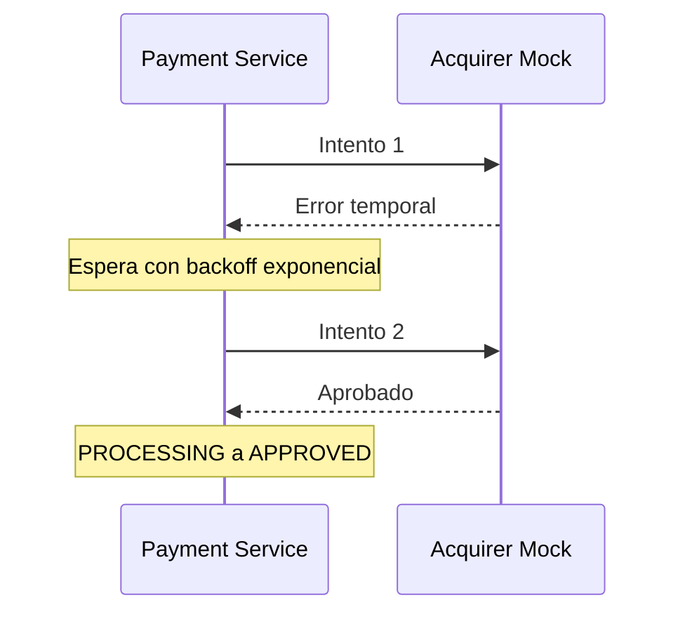
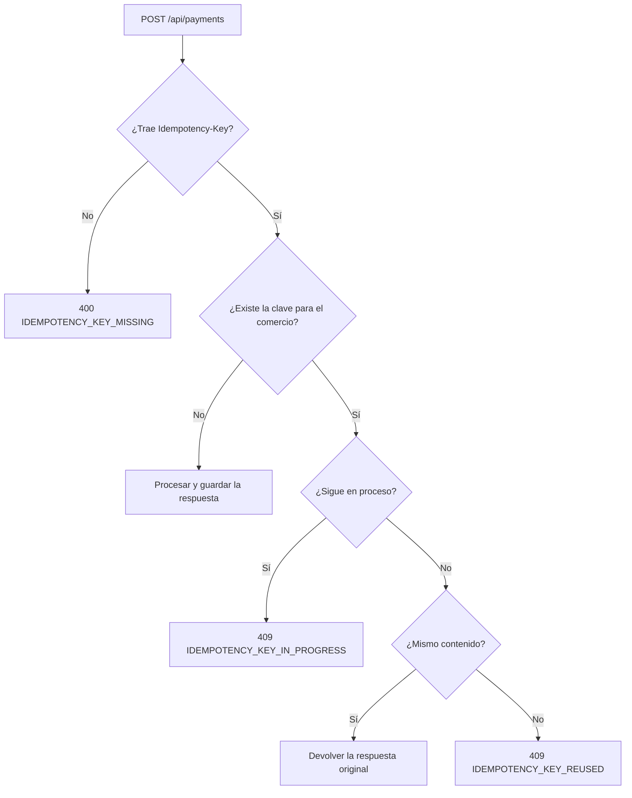

# Historias de usuario — Payment Processing Service

Cada historia se vincula con los requerimientos (`RF`, `RNF`) y supuestos (`SUP`) de
[01-requirements-analysis.md](01-requirements-analysis.md). Los criterios de aceptación (`CA`)
se expresan como reglas; los escenarios Gherkin son ejemplos ejecutables de esas reglas.

| ID | Historia | Cubre |
|----|----------|-------|
| [HU-01](#hu-01--enviar-un-pago) | Enviar un pago | RF-01, RF-02, RF-04, RF-06, RF-07 |
| [HU-02](#hu-02--rechazar-datos-de-entrada-inválidos) | Rechazar datos de entrada inválidos | RF-03, RNF-03 |
| [HU-03](#hu-03--aplicar-reglas-de-negocio) | Aplicar reglas de negocio | RF-05 |
| [HU-04](#hu-04--respetar-la-decisión-del-adquirente) | Respetar la decisión del adquirente | RF-06, RF-07 |
| [HU-05](#hu-05--tolerar-errores-temporales-del-adquirente) | Tolerar errores temporales del adquirente | RNF-05 |
| [HU-06](#hu-06--evitar-pagos-duplicados) | Evitar pagos duplicados | RNF-04 |
| [HU-07](#hu-07--consultar-una-transacción) | Consultar una transacción | RF-08 |
| [HU-08](#hu-08--listar-transacciones) | Listar transacciones | RF-09 |
| [HU-09](#hu-09--trazar-el-historial-de-la-transacción) | Trazar el historial de la transacción | RNF-02 |
| [HU-10](#hu-10--correlacionar-logs-y-eventos) | Correlacionar logs y eventos | RNF-06, RNF-07 |
| [HU-11](#hu-11--proteger-los-datos-de-tarjeta) | Proteger los datos de tarjeta | RNF-10 |
| [HU-12](#hu-12--consultar-transacciones-en-una-vista-web-opcional) | Consultar transacciones en una vista web *(opcional)* | RF-10 |

Contenido base que usan los escenarios (`una solicitud de pago válida`):

```json
{
  "merchant_id": "merchant-001",
  "amount": 15000,
  "currency": "CLP",
  "card": {
    "number": "4111111111111111",
    "holder_name": "Ada Lovelace",
    "expiry_month": 12,
    "expiry_year": 2030,
    "cvv": "123"
  }
}
```

Los nombres de campos, estados y códigos de error se mantienen en inglés porque forman parte del
contrato de la API.

---

## HU-01 — Enviar un pago

**Como** comercio
**quiero** enviar una solicitud de pago
**para** cobrarle a mi cliente y conocer el resultado de inmediato.

**Criterios de aceptación**

1. `POST /api/payments` con una solicitud válida y un `Idempotency-Key` crea exactamente una transacción.
2. La transacción comienza en `PENDING`, pasa a `PROCESSING` antes de llamar al adquirente y termina en un estado final.
3. La respuesta es `201 Created` e incluye `transaction_id`, `merchant_id`, `amount`, `currency`, `status`, `card.brand`, `card.last4`, `created_at` y `updated_at`.
4. La respuesta devuelve el estado final alcanzado durante la solicitud (procesamiento síncrono, SUP-07).

```gherkin
# language: es
Característica: Enviar un pago

  Escenario: Pago aprobado
    Dado una solicitud de pago válida con la tarjeta "4111111111111111"
    Y el header "Idempotency-Key" con valor "key-001"
    Cuando el comercio envía POST /api/payments
    Entonces el código de respuesta es 201
    Y el "status" de la respuesta es "APPROVED"
    Y la respuesta contiene un "transaction_id"
    Y el "card.last4" de la respuesta es "1111"
    Y existe exactamente 1 transacción para el comercio "merchant-001"

  Escenario: La transacción recorre los estados esperados
    Dado una solicitud de pago válida con la tarjeta "4111111111111111"
    Cuando el comercio envía POST /api/payments
    Entonces el historial de la transacción es "PENDING", "PROCESSING", "APPROVED" en ese orden
```

---

## HU-02 — Rechazar datos de entrada inválidos

**Como** comercio
**quiero** recibir errores claros cuando mi solicitud está mal formada
**para** corregirla sin tener que contactar a soporte.

**Criterios de aceptación**

1. La entrada se valida antes de crear cualquier transacción; si falla, **no** se persiste ninguna transacción (SUP-06).
2. La respuesta es `422` con el código `VALIDATION_ERROR` y un detalle por cada campo inválido.
3. Reglas: `merchant_id` texto obligatorio; `amount` entero positivo obligatorio en unidades mínimas de la moneda (un número con decimales o un texto se rechaza; ver SUP-02); `currency` uno de `CLP` o `USD`; `card.number` de 13 a 19 dígitos; `card.holder_name` obligatorio; `card.expiry_month` entre 1 y 12; `card.expiry_year` de cuatro dígitos; `card.cvv` de 3 o 4 dígitos.

```gherkin
# language: es
Característica: Rechazar datos de entrada inválidos

  Esquema del escenario: Un campo inválido se rechaza sin crear la transacción
    Dado una solicitud de pago válida
    Pero el campo "<campo>" tiene el valor <valor>
    Cuando el comercio envía POST /api/payments
    Entonces el código de respuesta es 422
    Y el código de error de la respuesta es "VALIDATION_ERROR"
    Y la respuesta informa un error para el campo "<campo>"
    Y no se persiste ninguna transacción

    Ejemplos:
      | campo             | valor              |
      | merchant_id       | null               |
      | amount            | 0                  |
      | amount            | -100               |
      | amount            | 10.50              |
      | amount            | "1050"             |
      | currency          | "EUR"              |
      | card.number       | "4111"             |
      | card.number       | "4111abcd11111111" |
      | card.expiry_month | 13                 |
      | card.cvv          | "12"               |

  Escenario: Se informan varios campos inválidos a la vez
    Dado una solicitud de pago sin "amount" y sin "currency"
    Cuando el comercio envía POST /api/payments
    Entonces el código de respuesta es 422
    Y la respuesta informa errores para los campos "amount" y "currency"
```

---

## HU-03 — Aplicar reglas de negocio

**Como** operador de la plataforma
**quiero** que los pagos que incumplen reglas de negocio se rechacen antes de llegar al adquirente
**para** evitar llamadas innecesarias y dejar registro del motivo del rechazo.

**Criterios de aceptación**

1. Las reglas de negocio se aplican **después** de crear la transacción en `PENDING` (SUP-06).
2. Si se incumple una regla, la transacción pasa de `PENDING` a `DECLINED` con un `decline_reason` y **no** se llama al adquirente.
3. Reglas: límite de monto por moneda (SUP-04) → `AMOUNT_LIMIT_EXCEEDED`; algoritmo de Luhn → `INVALID_CARD_NUMBER`; vencimiento anterior al mes en curso → `CARD_EXPIRED`.
4. La respuesta es `201` con `status` `DECLINED` y el `decline_reason`.
5. Un monto **igual** al límite está permitido.

```gherkin
# language: es
Característica: Aplicar reglas de negocio

  Esquema del escenario: Límite de monto por moneda
    Dado una solicitud de pago válida
    Y el "amount" es <monto> y la "currency" es "<moneda>"
    Cuando el comercio envía POST /api/payments
    Entonces el "status" de la respuesta es "<estado>"

    # Los montos están en unidades mínimas: en USD, 500000 = US$5.000,00 y 500001 = US$5.000,01.
    Ejemplos:
      | moneda | monto   | estado   |
      | CLP    | 5000000 | APPROVED |
      | CLP    | 5000001 | DECLINED |
      | USD    | 1050    | APPROVED |
      | USD    | 500000  | APPROVED |
      | USD    | 500001  | DECLINED |

  Escenario: Pago en USD con centavos
    Dado una solicitud de pago válida con "amount" 1050 en "USD"
    Cuando el comercio envía POST /api/payments
    Entonces el código de respuesta es 201
    Y el "amount" de la respuesta es 1050
    Y la "currency" de la respuesta es "USD"

  Escenario: Un monto sobre el límite se rechaza sin llamar al adquirente
    Dado una solicitud de pago válida con "amount" 5000001 en "CLP"
    Cuando el comercio envía POST /api/payments
    Entonces el código de respuesta es 201
    Y el "status" de la respuesta es "DECLINED"
    Y el "decline_reason" de la respuesta es "AMOUNT_LIMIT_EXCEEDED"
    Y no se llamó al adquirente

  Escenario: El número de tarjeta no cumple el algoritmo de Luhn
    Dado una solicitud de pago válida con la tarjeta "4111111111111112"
    Cuando el comercio envía POST /api/payments
    Entonces el "status" de la respuesta es "DECLINED"
    Y el "decline_reason" de la respuesta es "INVALID_CARD_NUMBER"
    Y no se llamó al adquirente

  Escenario: Tarjeta vencida
    Dado que hoy es "2026-10-15"
    Y una solicitud de pago válida con vencimiento en el mes 9 del año 2026
    Cuando el comercio envía POST /api/payments
    Entonces el "status" de la respuesta es "DECLINED"
    Y el "decline_reason" de la respuesta es "CARD_EXPIRED"

  Escenario: Una tarjeta que vence este mes sigue siendo válida
    Dado que hoy es "2026-10-15"
    Y una solicitud de pago válida con vencimiento en el mes 10 del año 2026
    Cuando el comercio envía POST /api/payments
    Entonces el "status" de la respuesta es "APPROVED"
```

---

## HU-04 — Respetar la decisión del adquirente

**Como** comercio
**quiero** que la transacción refleje la decisión del adquirente
**para** entregar productos solo cuando el pago esté autorizado.

**Criterios de aceptación**

1. Si el adquirente aprueba, la transacción pasa de `PROCESSING` a `APPROVED`.
2. Si el adquirente rechaza, pasa de `PROCESSING` a `DECLINED` y guarda el motivo del adquirente como `decline_reason`.
3. Un rechazo es una respuesta definitiva y **nunca** se reintenta.
4. Un estado final no puede cambiar después.

```gherkin
# language: es
Característica: Respetar la decisión del adquirente

  Escenario: El adquirente rechaza el pago
    Dado una solicitud de pago válida con la tarjeta "4000000000000002"
    Cuando el comercio envía POST /api/payments
    Entonces el código de respuesta es 201
    Y el "status" de la respuesta es "DECLINED"
    Y el "decline_reason" de la respuesta es "INSUFFICIENT_FUNDS"
    Y se llamó al adquirente exactamente 1 vez

  Escenario: Un estado final no admite otra transición
    Dado una transacción en estado "APPROVED"
    Cuando el sistema intenta cambiarla a "DECLINED"
    Entonces la transición es rechazada
    Y la transacción sigue en "APPROVED"
```

---

## HU-05 — Tolerar errores temporales del adquirente

**Como** comercio
**quiero** que el servicio reintente cuando el adquirente falla de forma temporal
**para** que una interrupción pasajera no se traduzca en ventas perdidas.

**Criterios de aceptación**

1. Los errores temporales (timeouts, respuestas `5xx`, fallos de conexión) se reintentan hasta 3 intentos en total con backoff exponencial (SUP-10).
2. Si un intento tiene éxito, la transacción toma el resultado de ese intento.
3. Si todos los intentos fallan, la transacción termina en `FAILED` con `decline_reason` `ACQUIRER_UNAVAILABLE`, y la respuesta sigue siendo `201`.
4. Cada intento queda registrado en el historial de la transacción con su número y su error.



```gherkin
# language: es
Característica: Tolerar errores temporales del adquirente

  Escenario: El adquirente se recupera tras un error temporal
    Dado una solicitud de pago válida con la tarjeta "4000000000000259"
    Cuando el comercio envía POST /api/payments
    Entonces el "status" de la respuesta es "APPROVED"
    Y se llamó al adquirente exactamente 2 veces
    Y el historial de la transacción registra 1 intento fallido al adquirente

  Escenario: El adquirente sigue fallando
    Dado una solicitud de pago válida con la tarjeta "4000000000000119"
    Cuando el comercio envía POST /api/payments
    Entonces el código de respuesta es 201
    Y el "status" de la respuesta es "FAILED"
    Y el "decline_reason" de la respuesta es "ACQUIRER_UNAVAILABLE"
    Y se llamó al adquirente exactamente 3 veces
```

---

## HU-06 — Evitar pagos duplicados

**Como** comercio
**quiero** poder reintentar una solicitud de forma segura cuando no recibo la respuesta
**para** que a mi cliente nunca se le cobre dos veces.

**Criterios de aceptación**

1. `POST /api/payments` exige el header `Idempotency-Key`; sin él, la respuesta es `400` `IDEMPOTENCY_KEY_MISSING`.
2. La clave es única **por comercio**: dos comercios pueden usar la misma clave de forma independiente.
3. Mismo comercio, misma clave y mismo contenido → se devuelve la respuesta original (mismo código y cuerpo) con el header `Idempotent-Replayed: true`, sin crear otra transacción.
4. Mismo comercio, misma clave y contenido distinto → `409` `IDEMPOTENCY_KEY_REUSED`. El CVV no forma parte del contenido comparado (SUP-11): con solo el CVV distinto, se devuelve la respuesta original.
5. Misma clave mientras la primera solicitud sigue en proceso → `409` `IDEMPOTENCY_KEY_IN_PROGRESS`.
6. Las solicitudes que fallan la validación de entrada (`422`) no reservan la clave.



```gherkin
# language: es
Característica: Evitar pagos duplicados

  Escenario: Falta la clave de idempotencia
    Dado una solicitud de pago válida
    Y sin el header "Idempotency-Key"
    Cuando el comercio envía POST /api/payments
    Entonces el código de respuesta es 400
    Y el código de error de la respuesta es "IDEMPOTENCY_KEY_MISSING"

  Escenario: Reintentar con la misma clave y contenido devuelve la respuesta original
    Dado que el comercio "merchant-001" ya envió una solicitud de pago válida con la clave "key-001"
    Cuando el comercio vuelve a enviar la misma solicitud con la clave "key-001"
    Entonces el código de respuesta es 201
    Y el header "Idempotent-Replayed" de la respuesta es "true"
    Y el "transaction_id" de la respuesta es igual al original
    Y existe exactamente 1 transacción para el comercio "merchant-001"
    Y se llamó al adquirente exactamente 1 vez en total

  Escenario: Misma clave con contenido distinto
    Dado que el comercio "merchant-001" ya envió un pago de 15000 CLP con la clave "key-001"
    Cuando el comercio envía un pago de 20000 CLP con la clave "key-001"
    Entonces el código de respuesta es 409
    Y el código de error de la respuesta es "IDEMPOTENCY_KEY_REUSED"

  Escenario: La misma clave usada por comercios distintos
    Dado que el comercio "merchant-001" ya envió una solicitud de pago válida con la clave "key-001"
    Cuando el comercio "merchant-002" envía una solicitud de pago válida con la clave "key-001"
    Entonces el código de respuesta es 201
    Y se crea una nueva transacción para el comercio "merchant-002"

  Escenario: Solicitudes concurrentes con la misma clave
    Dado que llegan al mismo tiempo dos solicitudes idénticas de "merchant-001" con la clave "key-001"
    Cuando ambas se procesan
    Entonces se crea exactamente 1 transacción
    Y la otra solicitud recibe la respuesta original o un 409 "IDEMPOTENCY_KEY_IN_PROGRESS"
```

---

## HU-07 — Consultar una transacción

**Como** analista de operaciones
**quiero** buscar una transacción por su identificador
**para** responder la consulta de un comercio sobre un pago específico.

**Criterios de aceptación**

1. `GET /api/payments/{transaction_id}` responde `200` con los mismos campos que la respuesta de creación, más el arreglo `events` (HU-09). La respuesta de creación no incluye eventos, para que la respuesta guardada para la repetición no dependa del historial.
2. Un identificador desconocido responde `404` `TRANSACTION_NOT_FOUND`.
3. Un identificador mal formado (que no es UUID) también responde `404`, sin exponer errores internos.

```gherkin
# language: es
Característica: Consultar una transacción

  Escenario: Transacción existente
    Dado que existe una transacción "APPROVED" con el identificador "9f1c..."
    Cuando el analista envía GET /api/payments/9f1c...
    Entonces el código de respuesta es 200
    Y el "status" de la respuesta es "APPROVED"

  Esquema del escenario: Transacción inexistente
    Cuando el analista envía GET /api/payments/<id>
    Entonces el código de respuesta es 404
    Y el código de error de la respuesta es "TRANSACTION_NOT_FOUND"

    Ejemplos:
      | id                                   |
      | 00000000-0000-0000-0000-000000000000 |
      | no-es-un-uuid                        |
```

---

## HU-08 — Listar transacciones

**Como** analista de operaciones
**quiero** listar transacciones filtradas por comercio y estado
**para** revisar la actividad de un comercio o encontrar pagos con problemas.

**Criterios de aceptación**

1. `GET /api/payments` acepta los filtros opcionales `merchant_id` y `status`, combinables entre sí.
2. Los resultados se ordenan del más reciente al más antiguo y se paginan: 20 por página por defecto, máximo 100 (SUP-13).
3. Un valor de `status` desconocido responde `422` `VALIDATION_ERROR`.
4. Si no hay coincidencias, responde `200` con una lista vacía.

```gherkin
# language: es
Característica: Listar transacciones

  Antecedentes:
    Dado que existen estas transacciones:
      | merchant_id  | status   |
      | merchant-001 | APPROVED |
      | merchant-001 | DECLINED |
      | merchant-001 | FAILED   |
      | merchant-002 | APPROVED |

  Escenario: Filtrar por comercio y estado
    Cuando el analista envía GET /api/payments?merchant_id=merchant-001&status=APPROVED
    Entonces el código de respuesta es 200
    Y la respuesta contiene 1 transacción

  Escenario: Filtrar solo por comercio
    Cuando el analista envía GET /api/payments?merchant_id=merchant-001
    Entonces la respuesta contiene 3 transacciones ordenadas de la más reciente a la más antigua

  Escenario: Sin coincidencias
    Cuando el analista envía GET /api/payments?merchant_id=merchant-999
    Entonces el código de respuesta es 200
    Y la respuesta contiene 0 transacciones

  Escenario: Filtro de estado inválido
    Cuando el analista envía GET /api/payments?status=PAID
    Entonces el código de respuesta es 422
    Y el código de error de la respuesta es "VALIDATION_ERROR"

  Escenario: El tamaño de página tiene un máximo
    Cuando el analista envía GET /api/payments?per_page=500
    Entonces el tamaño de página utilizado es 100
```

---

## HU-09 — Trazar el historial de la transacción

**Como** analista de operaciones
**quiero** ver cada paso por el que pasó una transacción
**para** explicar con exactitud qué ocurrió y cuándo.

**Criterios de aceptación**

1. Cada cambio de estado se guarda como un evento de solo inserción con: estado anterior, estado nuevo, motivo, fecha y hora, e identificador de correlación.
2. Cada intento al adquirente se guarda como un evento con número de intento, resultado y duración.
3. `GET /api/payments/{transaction_id}` incluye los eventos en orden cronológico.
4. Los eventos nunca se modifican ni se eliminan.

```gherkin
# language: es
Característica: Trazar el historial de la transacción

  Escenario: Historial de un pago que necesitó un reintento
    Dado una solicitud de pago válida con la tarjeta "4000000000000259"
    Cuando el comercio envía POST /api/payments
    Y el analista consulta esa transacción
    Entonces los eventos son, en orden:
      | tipo             | desde      | hasta      | detalle          |
      | STATUS_CHANGED   |            | PENDING    |                  |
      | STATUS_CHANGED   | PENDING    | PROCESSING |                  |
      | ACQUIRER_ATTEMPT |            |            | intento 1: error |
      | ACQUIRER_ATTEMPT |            |            | intento 2: ok    |
      | STATUS_CHANGED   | PROCESSING | APPROVED   |                  |
    Y todos los eventos tienen el mismo identificador de correlación que la transacción
```

---

## HU-10 — Correlacionar logs y eventos

**Como** analista de operaciones
**quiero** un identificador único que vincule cada línea de log y cada evento de una solicitud
**para** seguir el flujo completo de una transacción entre componentes.

**Criterios de aceptación**

1. Si la solicitud trae `X-Correlation-Id`, se usa ese valor; si no, se genera un UUID (SUP-12).
2. El identificador de correlación se devuelve en el header `X-Correlation-Id` de toda respuesta, incluidas las de error.
3. Se guarda en la transacción y en cada uno de sus eventos.
4. Cada línea de log escrita durante la solicitud incluye `correlation_id` y, una vez conocido, `transaction_id`.
5. El identificador de correlación se envía al adquirente.

```gherkin
# language: es
Característica: Correlacionar logs y eventos

  Escenario: Se propaga el identificador de correlación enviado por el cliente
    Dado una solicitud de pago válida
    Y el header "X-Correlation-Id" con valor "corr-123"
    Cuando el comercio envía POST /api/payments
    Entonces el header "X-Correlation-Id" de la respuesta es "corr-123"
    Y el "correlation_id" de la transacción es "corr-123"
    Y cada línea de log de la solicitud contiene "correlation_id" con valor "corr-123"

  Escenario: Se genera el identificador de correlación cuando falta
    Dado una solicitud de pago válida sin "X-Correlation-Id"
    Cuando el comercio envía POST /api/payments
    Entonces el header "X-Correlation-Id" de la respuesta es un UUID

  Escenario: Los errores también llevan el identificador de correlación
    Dado una solicitud de pago inválida
    Y el header "X-Correlation-Id" con valor "corr-456"
    Cuando el comercio envía POST /api/payments
    Entonces el código de respuesta es 422
    Y el header "X-Correlation-Id" de la respuesta es "corr-456"
```

---

## HU-11 — Proteger los datos de tarjeta

**Como** operador de la plataforma
**quiero** que los datos sensibles de la tarjeta nunca se guarden ni se registren en logs
**para** que una filtración de la base de datos o de los logs no exponga tarjetas utilizables.

**Criterios de aceptación**

1. Solo se persisten la marca y los últimos 4 dígitos de la tarjeta.
2. El CVV nunca se persiste, se registra en logs ni se devuelve.
3. El número completo de la tarjeta nunca aparece en respuestas, logs, eventos ni registros de idempotencia.

```gherkin
# language: es
Característica: Proteger los datos de tarjeta

  Escenario: Los datos de la tarjeta se enmascaran en todas partes
    Dado una solicitud de pago válida con la tarjeta "4111111111111111" y el CVV "123"
    Cuando el comercio envía POST /api/payments
    Entonces la respuesta contiene "card.brand" "VISA" y "card.last4" "1111"
    Y ni la respuesta, ni la base de datos, ni los logs contienen "4111111111111111"
    Y ni la base de datos ni los logs contienen el CVV
```

---

## HU-12 — Consultar transacciones en una vista web *(opcional)*

**Como** analista de operaciones
**quiero** una página web sencilla para buscar transacciones
**para** investigar pagos sin necesitar un cliente HTTP.

**Criterios de aceptación**

1. La página lista transacciones con filtros por comercio y estado, usando `GET /api/payments`.
2. Al seleccionar una transacción se muestran su detalle y su historial de eventos, usando `GET /api/payments/{transaction_id}`.
3. Los estados de carga, vacío y error son visibles.
4. La página cumple WCAG AA (navegación con teclado, etiquetas y contraste).

```gherkin
# language: es
Característica: Consultar transacciones en una vista web

  Escenario: Filtrar por estado
    Dado que el analista abre la página de transacciones
    Cuando selecciona el estado "DECLINED"
    Entonces solo se listan las transacciones rechazadas

  Escenario: Ver el historial de una transacción
    Dado que el analista está en la página de transacciones
    Cuando abre una transacción
    Entonces ve su detalle y sus eventos en orden cronológico

  Escenario: La API no está disponible
    Dado que la API no responde
    Cuando el analista abre la página de transacciones
    Entonces se muestra un mensaje de error con la opción de reintentar
```
