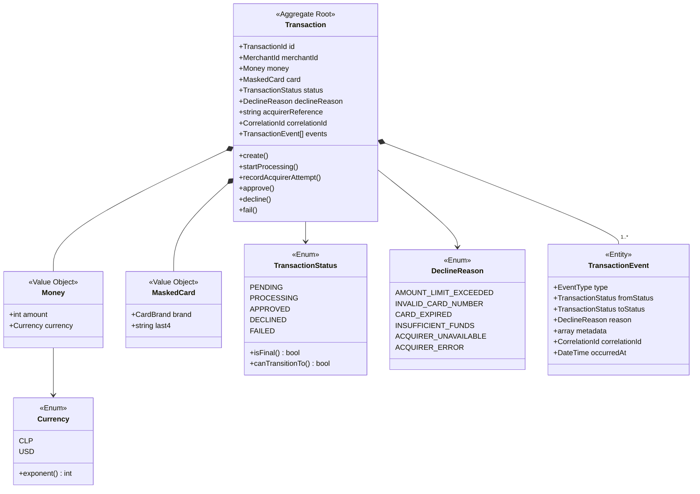
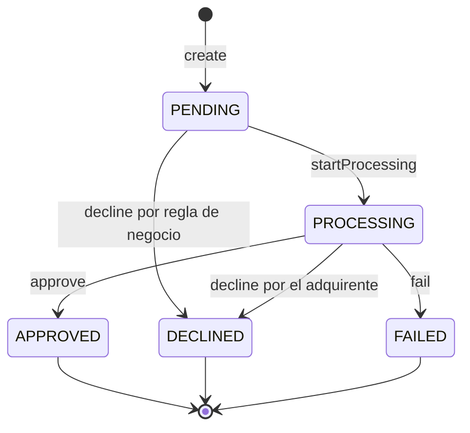
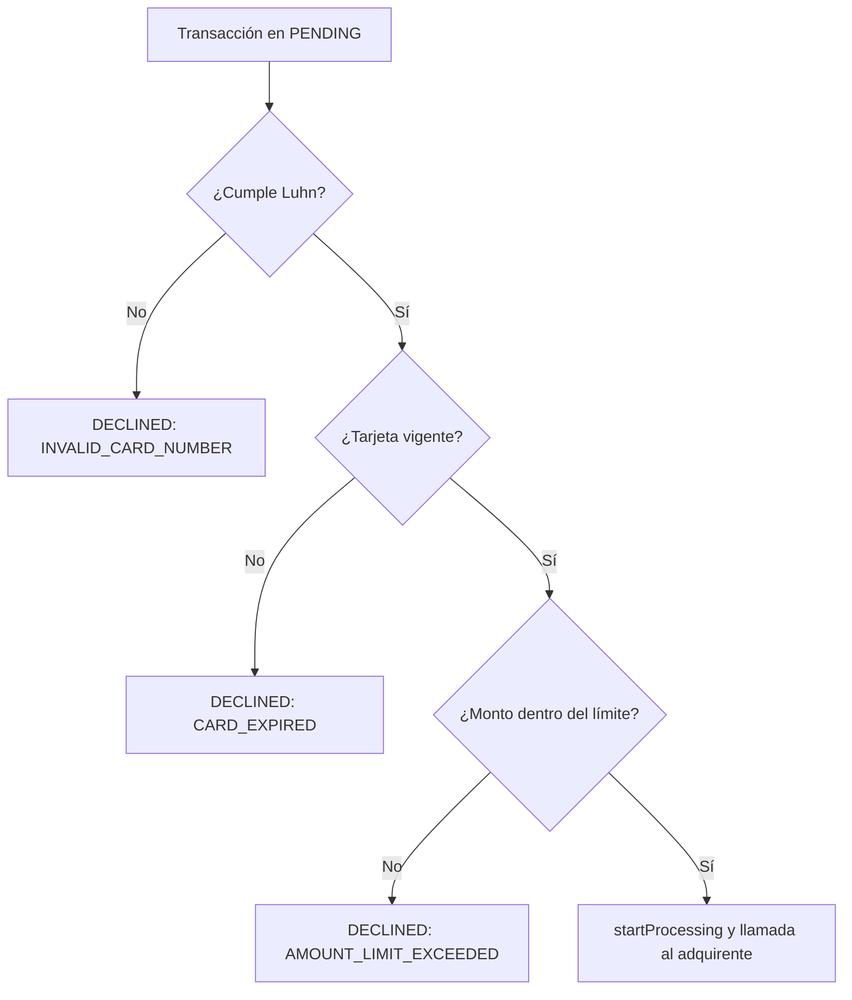
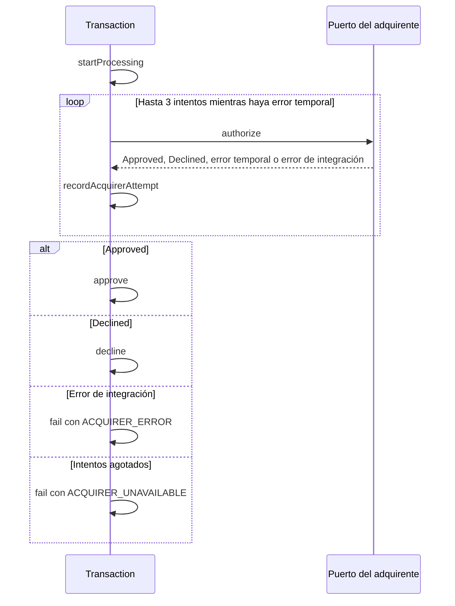
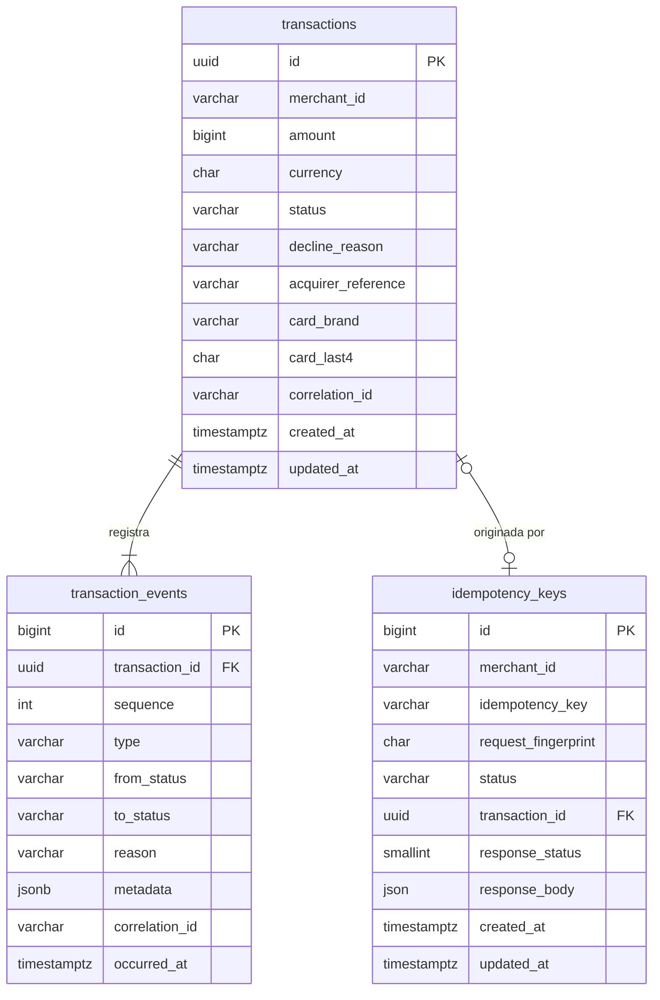
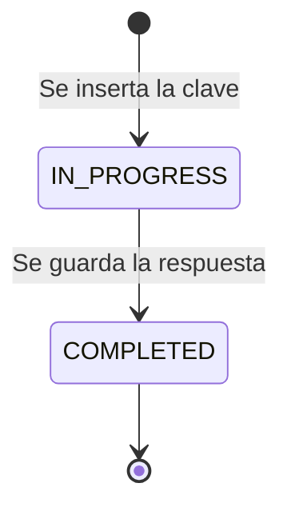

# Modelo de dominio — Payment Processing Service

Este documento define el lenguaje del dominio, el agregado `Transaction`, sus value objects,
las reglas de negocio, los eventos de trazabilidad y el modelo de datos. Se apoya en
[01-requirements-analysis.md](01-requirements-analysis.md) (requerimientos y supuestos `SUP`) y
en [02-user-stories.md](02-user-stories.md) (historias `HU`). Las decisiones de diseño se
registran como `DD-xx` en la [sección 8](#8-decisiones-de-diseño).

## 1. Glosario

| Término | Definición |
|---------|------------|
| Transacción | Intento de cobro de un comercio por un monto, con un ciclo de vida que termina en un estado final. Es la raíz del agregado. |
| Comercio | Cliente que envía pagos. Se identifica con `merchant_id` (SUP-01). |
| Adquirente | Sistema externo que autoriza o rechaza el cobro. En este proyecto es el Acquirer Mock. |
| Intento | Cada llamada al adquirente para una misma transacción. Puede haber hasta 3 (SUP-10). |
| Estado final | `APPROVED`, `DECLINED` o `FAILED`. Una vez alcanzado, no cambia. |
| Motivo de rechazo | Código que explica por qué una transacción terminó en `DECLINED` o `FAILED` (`decline_reason`). |
| Referencia de autorización | Código que entrega el adquirente al aprobar (`acquirer_reference`). |
| Evento | Registro inmutable de algo que le ocurrió a una transacción (cambio de estado o intento al adquirente). |
| Clave de idempotencia | Valor que envía el comercio para que un reintento no genere un segundo cobro (SUP-11). |
| Identificador de correlación | Valor que vincula logs, eventos y llamadas de una misma solicitud (SUP-12). |
| Unidades mínimas | Representación entera del monto según el exponente ISO 4217 de la moneda (SUP-02). |

## 2. Vista general

## 3. Agregado `Transaction`

`Transaction` es la única puerta de entrada para modificar una transacción y sus eventos. Ningún
otro componente cambia el estado ni inserta eventos directamente (DD-01).

### 3.1 Invariantes

1. El monto es un entero positivo en unidades mínimas y la moneda es soportada.
2. El estado solo cambia mediante las transiciones permitidas en la
   [sección 3.2](#32-máquina-de-estados).
3. Un estado final no cambia nunca más.
4. `decline_reason` existe **si y solo si** el estado es `DECLINED` o `FAILED`.
5. `acquirer_reference` existe **si y solo si** el estado es `APPROVED`.
6. Cada cambio de estado genera exactamente un evento `STATUS_CHANGED`, y cada llamada al
   adquirente genera exactamente un evento `ACQUIRER_ATTEMPT`.
7. Los eventos son de solo inserción: nunca se modifican ni se eliminan.
8. Solo se guardan la marca y los últimos 4 dígitos de la tarjeta; ni el número completo ni el
   CVV forman parte del agregado (HU-11).

### 3.2 Máquina de estados

| Desde \ Hacia | `PENDING` | `PROCESSING` | `APPROVED` | `DECLINED` | `FAILED` |
|---------------|-----------|--------------|------------|------------|----------|
| `PENDING` | No | Sí | No | Sí | No |
| `PROCESSING` | No | No | Sí | Sí | Sí |
| `APPROVED` | No | No | No | No | No |
| `DECLINED` | No | No | No | No | No |
| `FAILED` | No | No | No | No | No |

Una transición no permitida lanza `InvalidTransactionTransition` y no modifica el agregado.
Indica un error de programación, no una situación de negocio.

### 3.3 Operaciones

| Operación | Precondición | Efecto | Evento |
|-----------|--------------|--------|--------|
| `create` | Datos de entrada válidos | Estado `PENDING` | `STATUS_CHANGED` (nulo → `PENDING`) |
| `decline(reason)` | Estado `PENDING` o `PROCESSING` | Estado `DECLINED` con motivo | `STATUS_CHANGED` |
| `startProcessing` | Estado `PENDING` | Estado `PROCESSING` | `STATUS_CHANGED` |
| `recordAcquirerAttempt(attempt, outcome, durationMs, errorCode)` | Estado `PROCESSING` | Ninguno sobre el estado | `ACQUIRER_ATTEMPT` |
| `approve(reference)` | Estado `PROCESSING` | Estado `APPROVED` con referencia | `STATUS_CHANGED` |
| `fail(reason)` | Estado `PROCESSING` | Estado `FAILED` con motivo | `STATUS_CHANGED` |

## 4. Value objects

| Value object | Contenido | Reglas |
|--------------|-----------|--------|
| `TransactionId` | UUID v7 | Ordenable por tiempo (DD-02). |
| `MerchantId` | Texto | Obligatorio, de 1 a 64 caracteres. |
| `Money` | `amount` entero + `Currency` | `amount` mayor que 0. Se compara por monto y moneda; nunca se mezclan monedas. |
| `Currency` | Enum `CLP`, `USD` | Expone su exponente ISO 4217: CLP 0, USD 2 (SUP-02, SUP-03). |
| `CardNumber` | Número completo (**transitorio**) | 13 a 19 dígitos. Expone `passesLuhn()`, `brand()` y `last4()`. Nunca se persiste ni se registra en logs (DD-04). |
| `CardExpiry` | Mes y año | Vigente hasta el último día del mes indicado (DD-06). |
| `MaskedCard` | `CardBrand` + `last4` | Lo único de la tarjeta que se persiste. |
| `CardBrand` | Enum `VISA`, `MASTERCARD`, `AMEX`, `UNKNOWN` | Se deduce del prefijo del número (DD-05). |
| `IdempotencyKey` | Texto | Obligatorio, de 1 a 255 caracteres. Su ámbito es el comercio. |
| `CorrelationId` | Texto | Del header `X-Correlation-Id` (hasta 64 caracteres) o UUID generado. |

## 5. Reglas de negocio

Las reglas se aplican sobre la transacción en `PENDING`, en este orden, y la **primera** que falla
determina el motivo de rechazo (DD-07). Ninguna regla llama al adquirente.

| Orden | Regla | Falla cuando | Motivo |
|-------|-------|--------------|--------|
| 1 | Número de tarjeta válido | El número no cumple el algoritmo de Luhn. | `INVALID_CARD_NUMBER` |
| 2 | Tarjeta vigente | El mes y año de vencimiento son anteriores al mes en curso. | `CARD_EXPIRED` |
| 3 | Monto dentro del límite | `amount` supera el límite configurado para la moneda (SUP-04). | `AMOUNT_LIMIT_EXCEEDED` |

Cada regla es una política independiente con la misma interfaz, de modo que agregar una nueva
(por ejemplo, un límite por comercio) no modifica las existentes.

## 6. Puerto del adquirente

El dominio define el contrato que necesita y no depende de cómo se implementa el Acquirer Mock
(DD-08).

| Elemento | Descripción |
|----------|-------------|
| Solicitud | `transaction_id`, `merchant_id`, `Money`, `CardNumber`, `CardExpiry`, CVV y `CorrelationId`. Los datos sensibles viajan solo en memoria. |
| Respuesta `Approved` | Incluye la referencia de autorización. Es definitiva. |
| Respuesta `Declined` | Incluye el motivo (por ejemplo, `INSUFFICIENT_FUNDS`). Es definitiva y no se reintenta. |
| Error temporal | Timeout, error `5xx` o fallo de conexión. Es el único caso que se reintenta (SUP-10). |
| Error de integración | Cualquier otro `4xx`. No se reintenta, porque la misma solicitud volvería a fallar; la transacción termina en `FAILED` con `ACQUIRER_ERROR`. |

## 7. Eventos de trazabilidad

Cada evento guarda el identificador de correlación de la solicitud que lo originó y su fecha y
hora con precisión de microsegundos.

| Tipo | Cuándo | Datos propios |
|------|--------|---------------|
| `STATUS_CHANGED` | En cada cambio de estado, incluida la creación. | `from_status` (nulo al crear), `to_status` y `reason` cuando corresponde. |
| `ACQUIRER_ATTEMPT` | Después de cada llamada al adquirente. | En `metadata`: `attempt`, `outcome` (`APPROVED`, `DECLINED`, `TEMPORARY_ERROR`, `INTEGRATION_ERROR`), `duration_ms` y `error_code` cuando corresponde. |

Ejemplo del historial de un pago que necesitó un reintento (HU-09):

| # | Tipo | Desde | Hacia | Metadata |
|---|------|-------|-------|----------|
| 1 | `STATUS_CHANGED` | | `PENDING` | |
| 2 | `STATUS_CHANGED` | `PENDING` | `PROCESSING` | |
| 3 | `ACQUIRER_ATTEMPT` | | | `{"attempt": 1, "outcome": "TEMPORARY_ERROR", "duration_ms": 2001, "error_code": "TIMEOUT"}` |
| 4 | `ACQUIRER_ATTEMPT` | | | `{"attempt": 2, "outcome": "APPROVED", "duration_ms": 85}` |
| 5 | `STATUS_CHANGED` | `PROCESSING` | `APPROVED` | |

## 8. Decisiones de diseño

| ID | Decisión | Motivo |
|----|----------|--------|
| DD-01 | `Transaction` es la raíz del agregado y los eventos se crean solo a través de sus operaciones. | Garantiza las invariantes en un único lugar y que ningún cambio de estado quede sin evento. |
| DD-02 | El identificador es UUID v7. | No es adivinable como un autoincremental, no revela volumen de negocio y, al ser ordenable por tiempo, mantiene los índices compactos. |
| DD-03 | El estado actual se guarda en `transactions` y el historial en `transaction_events`. | Consultar y filtrar por estado es directo, y el historial completo queda disponible para trazabilidad. No se usa event sourcing: aumentaría la complejidad sin que el enunciado lo requiera. |
| DD-04 | `CardNumber` y el CVV son transitorios: existen solo en memoria durante la solicitud. | Una filtración de la base de datos o de los logs no expone tarjetas utilizables (HU-11). |
| DD-05 | La marca se deduce por prefijo: `4` VISA; `51`–`55` y `2221`–`2720` MASTERCARD; `34` y `37` AMEX; el resto `UNKNOWN`. Una marca `UNKNOWN` no es motivo de rechazo. | La marca es informativa; la validez la determinan Luhn y el adquirente. |
| DD-06 | El vencimiento se evalúa contra el mes en curso en UTC, mediante un reloj inyectable. | Las pruebas pueden fijar la fecha, y una tarjeta que vence este mes sigue siendo válida (HU-03). |
| DD-07 | Las reglas se evalúan en orden fijo y se detienen en la primera falla. | El motivo de rechazo es determinista y fácil de explicar. |
| DD-08 | El adquirente se accede mediante un puerto definido por el dominio. | El Acquirer Mock se puede reemplazar por un adquirente real o por un doble de prueba sin cambiar el dominio. |
| DD-09 | La idempotencia se registra en una tabla propia, con unicidad por `(merchant_id, idempotency_key)`. | La restricción única de la base de datos resuelve la concurrencia: de dos solicitudes simultáneas, solo una logra insertar (HU-06). |
| DD-10 | La huella del contenido (`request_fingerprint`) es un HMAC-SHA256 del contenido normalizado, firmado con la clave de la aplicación. El contenido excluye el CVV, la clave de idempotencia y el identificador de correlación. | Permite detectar "misma clave, contenido distinto" sin guardar el número de tarjeta. Un SHA-256 simple de un número de tarjeta se puede revertir por fuerza bruta. El CVV no se conserva en ninguna forma después de autorizar (PCI DSS), ni siquiera como hash; por eso, la misma solicitud con otro CVV se considera el mismo contenido. |
| DD-11 | Los eventos son de solo inserción también en la base de datos, mediante un trigger que rechaza `UPDATE` y `DELETE`. | La trazabilidad no depende solo de la disciplina del código. |
| DD-12 | `transactions` tiene restricciones `CHECK` para estado, moneda, monto positivo y coherencia entre estado, `decline_reason` y `acquirer_reference`. | Las invariantes 1, 4 y 5 se cumplen incluso ante un error en la aplicación. |

## 9. Modelo de datos

### 9.1 `transactions`

| Columna | Tipo | Nulo | Notas |
|---------|------|------|-------|
| `id` | `uuid` | No | PK, UUID v7. |
| `merchant_id` | `varchar(64)` | No | |
| `amount` | `bigint` | No | Unidades mínimas. `CHECK (amount > 0)`. |
| `currency` | `char(3)` | No | `CHECK (currency IN ('CLP', 'USD'))`. |
| `status` | `varchar(16)` | No | `CHECK` con los 5 estados. |
| `decline_reason` | `varchar(32)` | Sí | Obligatorio solo en `DECLINED` y `FAILED` (DD-12). |
| `acquirer_reference` | `varchar(64)` | Sí | Obligatorio solo en `APPROVED` (DD-12). |
| `card_brand` | `varchar(16)` | No | |
| `card_last4` | `char(4)` | No | |
| `correlation_id` | `varchar(64)` | No | |
| `created_at`, `updated_at` | `timestamptz` | No | |

Índices:

- `(merchant_id, created_at DESC)`: listado por comercio, del más reciente al más antiguo.
- `(status, created_at DESC)`: listado por estado.
- `(created_at DESC)`: listado sin filtros.

### 9.2 `transaction_events`

| Columna | Tipo | Nulo | Notas |
|---------|------|------|-------|
| `id` | `bigint` | No | PK autoincremental; define el orden de inserción. |
| `transaction_id` | `uuid` | No | FK a `transactions`. |
| `sequence` | `int` | No | Número del evento dentro de la transacción, asignado por el agregado. `UNIQUE (transaction_id, sequence)`: guardar dos veces el mismo evento no lo duplica. |
| `type` | `varchar(32)` | No | `STATUS_CHANGED` o `ACQUIRER_ATTEMPT`. |
| `from_status` | `varchar(16)` | Sí | Nulo en la creación y en `ACQUIRER_ATTEMPT`. |
| `to_status` | `varchar(16)` | Sí | Nulo en `ACQUIRER_ATTEMPT`. |
| `reason` | `varchar(32)` | Sí | |
| `metadata` | `jsonb` | Sí | Datos propios del tipo de evento. |
| `correlation_id` | `varchar(64)` | No | |
| `occurred_at` | `timestamptz(6)` | No | Precisión de microsegundos. |

Índice: `(transaction_id, id)` para obtener el historial en orden. Sin `updated_at`: los eventos
no se modifican (DD-11).

### 9.3 `idempotency_keys`

| Columna | Tipo | Nulo | Notas |
|---------|------|------|-------|
| `id` | `bigint` | No | PK. |
| `merchant_id` | `varchar(64)` | No | |
| `idempotency_key` | `varchar(255)` | No | `UNIQUE (merchant_id, idempotency_key)` (DD-09). |
| `request_fingerprint` | `char(64)` | No | HMAC-SHA256 en hexadecimal (DD-10). |
| `status` | `varchar(16)` | No | `IN_PROGRESS` o `COMPLETED`. |
| `transaction_id` | `uuid` | Sí | FK a `transactions`; se completa al crear la transacción. |
| `response_status` | `smallint` | Sí | Se completa al terminar. |
| `response_body` | `json` | Sí | Respuesta original, ya enmascarada, para devolverla en los reintentos. Es `json` y no `jsonb` porque `jsonb` reordena las claves, y la repetición debe devolver exactamente el mismo cuerpo (HU-06). |
| `created_at`, `updated_at` | `timestamptz` | No | |

## 10. Limitaciones conocidas

- **Clave bloqueada en `IN_PROGRESS`**: si el proceso termina de forma abrupta entre la reserva
  de la clave y la respuesta, la clave queda en `IN_PROGRESS` y los reintentos reciben `409`. En
  producción se resolvería con un vencimiento del bloqueo y un proceso de conciliación; queda
  fuera del alcance.
- **Resultado ambiguo del adquirente**: ver SUP-15 en el análisis de requerimientos.
- **Retención**: las claves de idempotencia no expiran. En producción se depurarían después de
  un plazo (por ejemplo, 24 horas).
