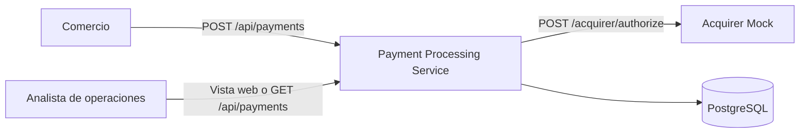
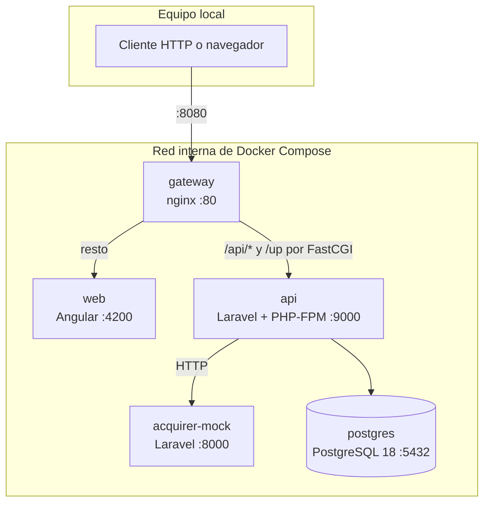
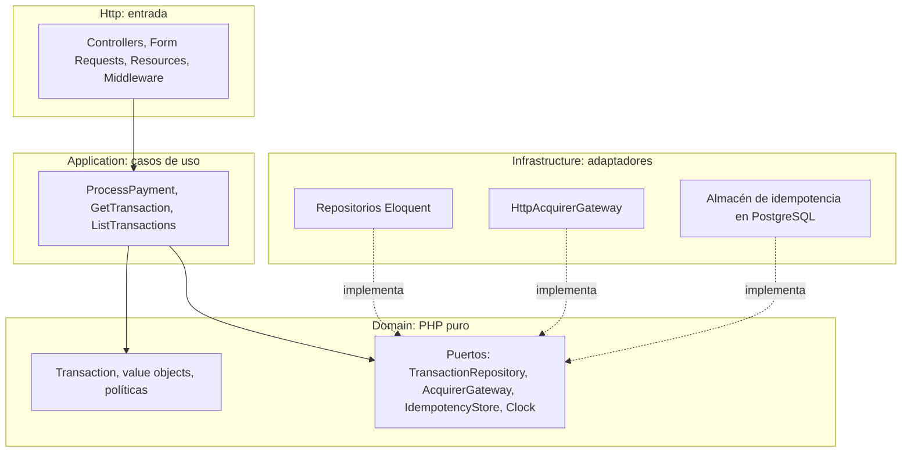
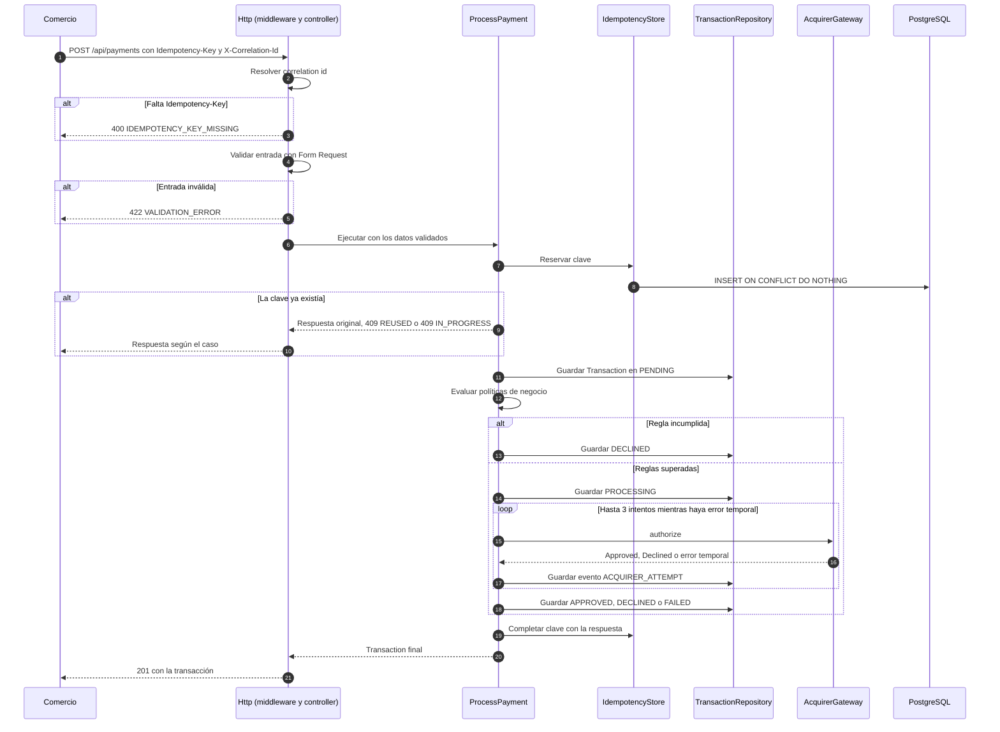
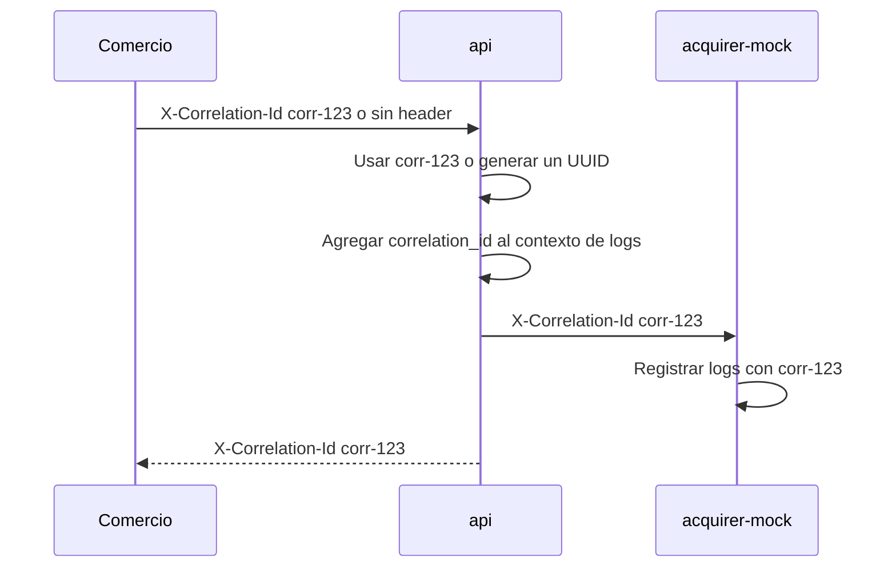

# Arquitectura — Payment Processing Service

Este documento describe la arquitectura de alto nivel, los componentes, el flujo de una
transacción, la integración con el adquirente, la observabilidad y la estrategia de pruebas. Se
apoya en [01-requirements-analysis.md](01-requirements-analysis.md),
[02-user-stories.md](02-user-stories.md) y [03-domain-model.md](03-domain-model.md). Las
decisiones de arquitectura se registran como `DA-xx` en la
[sección 10](#10-decisiones-de-arquitectura).

## 1. Contexto



## 2. Contenedores

Todo se levanta con Docker Compose. El único punto de entrada desde fuera es el gateway en el
puerto `8080`.



| Contenedor | Imagen | Responsabilidad |
|------------|--------|-----------------|
| `gateway` | `nginx:1.29-alpine` | Punto de entrada único. Envía `/api/*` y `/up` a la API y el resto a la vista web. |
| `web` | `node:24-alpine` | Vista Angular opcional para consultar transacciones (HU-12). Usa la API por el mismo origen, sin CORS. |
| `api` | `api/Dockerfile` | Payment Processing Service: validación, reglas, idempotencia, persistencia y llamada al adquirente. |
| `acquirer-mock` | `api/Dockerfile` (misma imagen) | Simula al adquirente. **No** se expone por el gateway: solo es accesible desde la red interna (DA-03). |
| `postgres` | `postgres:18-alpine` | Persistencia de transacciones, eventos y claves de idempotencia. |

## 3. Capas dentro de la API

La API es un monolito modular con arquitectura hexagonal (puertos y adaptadores) dentro de
Laravel (DA-01). La estructura de carpetas expresa el dominio, no el framework.



```text
api/app/
├── Payments/
│   ├── Domain/            # Transaction, value objects, enums, políticas y puertos (sin Laravel)
│   ├── Application/       # Casos de uso, política de reintentos y DTOs
│   ├── Infrastructure/    # Eloquent, cliente HTTP del adquirente, idempotencia
│   └── Http/              # Controllers, Form Requests, API Resources
├── AcquirerMock/          # Endpoint del simulador, activo solo en el contenedor acquirer-mock
└── Shared/                # Correlación, logging y formato de errores
```

Regla de dependencias (DA-02):

| Capa | Puede depender de | No puede depender de |
|------|-------------------|----------------------|
| `Domain` | Nada externo | Laravel, Eloquent, HTTP, otras capas |
| `Application` | `Domain` | Eloquent, HTTP |
| `Infrastructure` | `Domain`, `Application`, Laravel | `Http` |
| `Http` | `Application`, Laravel | `Infrastructure` (se resuelve por el contenedor de dependencias) |

Estas reglas se verifican con pruebas de arquitectura de Pest, de modo que una violación rompe
la suite (DA-10).

## 4. Flujo de `POST /api/payments`



### 4.1 Límites transaccionales

Ninguna transacción de base de datos queda abierta durante la llamada HTTP al adquirente
(DA-04). Cada paso se confirma por separado:

1. La reserva de la clave de idempotencia se confirma de inmediato, para que una solicitud
   concurrente la vea.
2. La creación en `PENDING` (con su evento) se confirma antes de evaluar las reglas.
3. El paso a `PROCESSING` se confirma **antes** de llamar al adquirente. Si el proceso se cae a
   mitad de camino, la transacción queda visible en `PROCESSING` y no desaparece.
4. Cada intento al adquirente y el estado final se confirman junto con su evento, en la misma
   transacción de base de datos.

### 4.2 Consultas

`GET /api/payments/{transaction_id}` y `GET /api/payments` son lecturas directas mediante el
repositorio, sin efectos secundarios. El detalle incluye los eventos en orden (HU-09).

## 5. Integración con el adquirente

### 5.1 Contrato HTTP del Acquirer Mock

`POST http://acquirer-mock:8000/acquirer/authorize`, con el header `X-Correlation-Id`.

```json
{
  "transaction_id": "0199f0c2-6a1e-7c3a-9b2f-5d1e8a4c7b10",
  "merchant_id": "merchant-001",
  "amount": 15000,
  "currency": "CLP",
  "card": {
    "number": "4111111111111111",
    "expiry_month": 12,
    "expiry_year": 2030,
    "cvv": "123"
  }
}
```

| Respuesta | Cuerpo | Interpretación |
|-----------|--------|----------------|
| `200` | `{"status": "APPROVED", "authorization_code": "A1B2C3"}` | Aprobación definitiva. |
| `200` | `{"status": "DECLINED", "reason": "INSUFFICIENT_FUNDS"}` | Rechazo definitivo; no se reintenta. |
| `503` | `{"error": "TEMPORARY_UNAVAILABLE"}` | Error temporal; se reintenta. |
| Timeout o fallo de conexión | | Error temporal; se reintenta. |
| Cualquier otro `4xx` | | Error de integración: `FAILED` con `ACQUIRER_ERROR`, sin reintentar, y log de nivel `error`. |

El comportamiento depende de la tarjeta de prueba (ver
[tarjetas de prueba](01-requirements-analysis.md#7-tarjetas-de-prueba-del-acquirer-mock)). Para
la tarjeta que falla una vez y luego aprueba, el mock cuenta los intentos por `transaction_id`
en su caché local.

### 5.2 Ejecución del mock

- Usa la misma imagen y el mismo código que la API, pero corre `php artisan serve` con varios
  workers (`PHP_CLI_SERVER_WORKERS`), suficiente para un simulador.
- Sus rutas se registran solo cuando `ACQUIRER_MOCK_ENABLED=true`, variable que únicamente tiene
  ese contenedor. En la API las rutas no existen (DA-03).
- No usa la base de datos ni ejecuta migraciones.
- No recibe `APP_KEY` (se define vacía para que tampoco la tome de `api/.env`) y corre con
  `APP_DEBUG=false`: no cifra ni firma nada, y así nunca tiene la clave que firma las huellas de
  idempotencia de la API.
- Corre con `--no-reload`: sin esa opción, `artisan serve` solo pasa a sus workers una lista fija de
  variables de entorno cuando existe `api/.env`, y `ACQUIRER_MOCK_ENABLED` no llegaría. Además,
  sin `--no-reload` ignora `PHP_CLI_SERVER_WORKERS` y atiende con un solo proceso.
- El cliente de la API no sigue redirecciones del adquirente: una redirección reenviaría los datos
  de tarjeta a otro host. Una respuesta `3xx` se trata como error de integración.

### 5.3 Política de reintentos

El bucle de reintentos vive en la capa de aplicación y no en el cliente HTTP, para que cada
intento quede registrado como evento (DA-05).

| Parámetro | Valor |
|-----------|-------|
| Intentos máximos | 3 en total |
| Timeout de conexión | 1 s |
| Timeout por intento | 2 s |
| Espera entre intentos | Backoff exponencial de 200 ms y 400 ms, con jitter |
| Peor caso de latencia | Unos 7 s, por debajo del timeout de FastCGI del gateway (60 s) |

Los valores se configuran por variables de entorno.

## 6. Persistencia

El modelo de datos está definido en el
[modelo de dominio](03-domain-model.md#9-modelo-de-datos). En la implementación:

- El dominio no conoce Eloquent: los repositorios traducen entre `Transaction` y los modelos
  Eloquent de `Infrastructure` (DA-02).
- Las migraciones crean las restricciones `CHECK`, los índices y el trigger que impide modificar
  o borrar eventos.
- La reserva de la clave de idempotencia usa `INSERT ... ON CONFLICT DO NOTHING`: si no se
  insertó ninguna fila, la clave ya existía (DA-06).

## 7. Observabilidad

### 7.1 Correlación



- Un middleware resuelve el identificador y lo agrega al `Context` de Laravel, que lo incluye
  automáticamente en cada línea de log (DA-07).
- Una vez creada la transacción, se agrega también `transaction_id` al contexto.
- El identificador se guarda en la transacción y en cada evento, y viaja al adquirente.
- Con `docker compose logs | grep corr-123` se sigue una transacción a través de `api` y
  `acquirer-mock`.

### 7.2 Logs estructurados

Los logs se escriben en JSON por `stderr`, para que Docker los recolecte. Eventos de log
principales:

| Mensaje | Nivel | Cuándo |
|---------|-------|--------|
| `payment.received` | `info` | Llega una solicitud. |
| `payment.validation_failed` | `info` | La entrada es inválida. |
| `idempotency.replayed` | `info` | Se devuelve una respuesta guardada. |
| `idempotency.conflict` | `warning` | Misma clave con contenido distinto, o clave en proceso. |
| `transaction.created` | `info` | Transacción en `PENDING`. |
| `transaction.declined_by_rule` | `info` | Una política rechaza la transacción. |
| `acquirer.attempt` | `info` o `warning` | Resultado de cada intento, con duración. |
| `transaction.finalized` | `info` | Estado final alcanzado. |
| `payment.unexpected_error` | `error` | Excepción no controlada. |

Nunca se registran el número de tarjeta ni el CVV (HU-11). Una prueba verifica que no aparezcan
en los logs.

## 8. Manejo de errores

Todas las respuestas de error usan el mismo formato, construido en un único punto
(`withExceptions` en `bootstrap/app.php`):

```json
{
  "error": {
    "code": "VALIDATION_ERROR",
    "message": "The given data was invalid.",
    "details": {
      "amount": ["The amount field must be an integer."]
    }
  }
}
```

| Origen | Código HTTP | `code` |
|--------|-------------|--------|
| Falta `Idempotency-Key` | 400 | `IDEMPOTENCY_KEY_MISSING` |
| Validación de entrada | 422 | `VALIDATION_ERROR` |
| Transacción inexistente | 404 | `TRANSACTION_NOT_FOUND` |
| Ruta inexistente bajo `/api` | 404 | `NOT_FOUND` |
| Otro error HTTP del framework (por ejemplo, método no permitido) | Su código | `HTTP_ERROR` |
| Conflicto de idempotencia | 409 | `IDEMPOTENCY_KEY_REUSED` o `IDEMPOTENCY_KEY_IN_PROGRESS` |
| Excepción no controlada | 500 | `INTERNAL_ERROR`, sin detalles internos |

Los rechazos de negocio y del adquirente **no** son errores HTTP: son transacciones creadas con
`status` `DECLINED` o `FAILED` y código `201` (SUP-08).

## 9. Estrategia de pruebas

| Tipo | Qué cubre | Cómo |
|------|-----------|------|
| Unitarias | Agregado, value objects, políticas, política de reintentos | PHP puro, sin base de datos ni framework. Reloj fijo para el vencimiento. |
| Feature | Endpoints y escenarios Gherkin de las historias | Pest contra PostgreSQL, con el adquirente simulado mediante `Http::fake`. |
| Contrato del mock | Respuestas del Acquirer Mock por tarjeta de prueba | Pest sobre las rutas del mock. |
| Arquitectura | Regla de dependencias entre capas | `arch()` de Pest. |
| Frontend | Componentes y servicio de la vista web | Vitest. |

Las pruebas usan PostgreSQL y no SQLite, porque dependen de `CHECK`, del trigger y de
`ON CONFLICT` (DA-09).

## 10. Decisiones de arquitectura

| ID | Decisión | Motivo |
|----|----------|--------|
| DA-01 | Monolito modular con arquitectura hexagonal dentro de Laravel. | Separa responsabilidades sin el costo operativo de microservicios. El módulo `Payments` podría extraerse si fuera necesario. |
| DA-02 | El dominio es PHP puro; Eloquent solo existe en `Infrastructure`. | Las reglas de negocio se prueban sin base de datos y no dependen del framework. A cambio, los repositorios deben mapear entre el agregado y los modelos. |
| DA-03 | El Acquirer Mock es un contenedor aparte con la misma imagen de la API, con sus rutas activas solo por variable de entorno y sin exposición por el gateway. | Hay una red real (timeouts, `5xx`, reintentos), y el adaptador HTTP sirve para un adquirente real, sin mantener otro proyecto. |
| DA-04 | Procesamiento síncrono, sin transacciones de base de datos abiertas durante llamadas HTTP. | No se bloquean filas ni conexiones mientras se espera al adquirente, y un fallo deja el estado intermedio visible. |
| DA-05 | Los reintentos se implementan en la capa de aplicación con una política configurable. | Cada intento queda registrado como evento (HU-05, HU-09). |
| DA-06 | La reserva de idempotencia usa `INSERT ... ON CONFLICT DO NOTHING` sobre la restricción única. | Resuelve la concurrencia en la base de datos, sin locks de aplicación (HU-06). |
| DA-07 | Logs JSON por `stderr`, con el `Context` de Laravel para la correlación. | Cada línea lleva `correlation_id` y `transaction_id` sin pasarlos a mano. |
| DA-08 | Los endpoints quedan bajo el prefijo `/api` (`/api/payments`), sin versión en la ruta. | El gateway enruta `/api` a Laravel. Si hubiera cambios incompatibles, se agregaría una versión (`/api/v2`). |
| DA-09 | Las pruebas corren contra PostgreSQL. | Las invariantes en base de datos (restricciones, trigger, `ON CONFLICT`) también se prueban. |
| DA-10 | La regla de dependencias entre capas se verifica con pruebas de arquitectura. | La arquitectura no depende solo de la disciplina de quien escribe el código. |

## 11. Evolución

Fuera del alcance del desafío, pero considerado en el diseño:

- **Procesamiento asíncrono**: responder `202` con la transacción en `PENDING` y procesarla en
  una cola, notificando el resultado por webhook. El caso de uso no cambia; solo cambia quién lo
  invoca.
- **Patrón outbox**: publicar los eventos de `transaction_events` a un bus de mensajes para
  otros sistemas (conciliación, antifraude).
- **Circuit breaker** frente al adquirente, para dejar de llamarlo durante una caída prolongada.
- **Varios adquirentes**: nuevos adaptadores del mismo puerto y una política de enrutamiento.
- **Seguridad**: autenticación de comercios con API keys, rate limiting y tokenización de
  tarjetas en una bóveda PCI DSS.
- **Observabilidad**: métricas (latencia del adquirente, tasa de aprobación) y trazas
  distribuidas con OpenTelemetry.
- **Recuperación**: un proceso que concilie transacciones detenidas en `PROCESSING` y claves en
  `IN_PROGRESS` consultando al adquirente.
